<div align="center">

# ⚡ ESPHome Energy Dashboard

**Visualize Your Home's Energy Flow in Real-Time!**



[](https://esphome.io/)
[](https://www.home-assistant.io/)
[](LICENSE)
[](https://github.com/firsttris/esphome-energy-dashboard/actions/workflows/build.yml)

A modular ESPHome project that visualizes daily energy distribution similar to Home Assistant, with real-time data on solar production, grid consumption/feed-in, battery status, and gas consumption, on the [Guition-ESP32-S3-4848S040](https://devices.esphome.io/devices/guition-esp32-s3-4848s040/) display.

---

</div>

## 📱 Features

- **🔄 Energy Flow Visualization**: See your energy distribution at a glance – flows animate only while power is actually flowing, and faster the more power flows
- **☀️ Solar Production Monitoring**: Track your daily solar generation
- **🔋 Battery Status**: Real-time battery state of charge
- **📊 Dual Page Display**: 
  - Page 1: Daily accumulated energy consumption (Home Assistant style)
  - Page 2: Current load table with detailed breakdown
- **👆 Touch Interface**: Simply tap the screen to switch between views
- **🌙 Auto-Dimming**: Backlight dims after inactivity, a tap wakes it up
- **📡 Offline Indicator**: A small cloud icon shows when Home Assistant is disconnected
- **🎨 Modular Design**: Easy to customize and extend

## 📋 Prerequisites

| Requirement | Description |
|-------------|-------------|
| **🔧 Hardware** | [Guition-ESP32-S3-4848S040](https://devices.esphome.io/devices/guition-esp32-s3-4848s040/) (ESP32-S3 with 4.8" IPS touch display) |
| **🏠 Home Assistant** | With ESPHome Integration for sensor data |
| **💻 Software** | ESPHome (local or Docker/Podman) |
| **🔌 Cable** | USB cable for initial flashing |

---

## 🚀 Installation and Setup

### 📝 Step 1: Clone the Repository

```bash
git clone https://github.com/firsttris/esphome-energy-dashboard.git
cd esphome-energy-dashboard
```

### 🔐 Step 2: Configure Secrets

Copy the example and fill in your own values:

```bash
cp secrets.example.yaml secrets.yaml
```

```yaml
wifi_ssid: "Your_WiFi_Name"
wifi_password: "Your_WiFi_Password"
api_key: "Your_ESPHOME_API_Key"          # Generate a secure key
fallback_password: "Your_Fallback_Password"  # Password of the fallback hotspot
```

> **💡 Important**: Use a strong API key (e.g., 32 characters long). You can generate one with:
> ```bash
> openssl rand -base64 32
> ```

### ⚙️ Step 3: Customize Entity IDs

Customize the project to your requirements.
Ensure that the entity IDs in [sensors/homeassistant.yml](sensors/homeassistant.yml) match your HA sensors:

**Daily values** (shown on the dashboard):

| ID | Meaning | Example Entity ID |
|----|---------|-------------------|
| `solar_power` | ☀️ Solar production today (kWh) | `sensor.deye_wechselrichter_deye_tagliche_produktion` |
| `grid_power` / `grid_feed_in` | 🔌 Grid import / feed-in today (kWh) | `sensor.deye_wechselrichter_deye_taglich_energie_bezogen` |
| `home_power` | 🏠 Home consumption today (kWh) | `sensor.strom_tagesverbrauch` |
| `battery_soc` | 🔋 Battery state of charge (%) | `sensor.deye_wechselrichter_deye_batterie_soc` |
| `battery_charge` / `battery_discharge` | 🔋 Battery charged / discharged today (kWh) | `sensor.deye_wechselrichter_deye_tagliche_batterie_ladung` |
| `gas_power` / `water_power` | 🔥💧 Gas / water today (m³) | `sensor.gas_tagesverbrauch` |
| `heating_rod_daily_energy` | ♨️ Heating rod today (kWh) | `sensor.ac_elwa_2_energy_consumption_daily` |

**Current power** (drives the flow animations and the power table):

| ID | Meaning | Sign convention |
|----|---------|-----------------|
| `current_solar_power` | ☀️ PV power (W) | |
| `current_grid_power` | 🔌 Grid power (W) | **positive = import, negative = feed-in** |
| `current_battery_power` | 🔋 Battery power (W) | **positive = discharging, negative = charging** |
| `current_home_consumption` | 🏠 Home consumption (W) | |
| `current_pv_surplus` | ☀️ PV surplus (W) | |
| `current_heating_rod_power` | ♨️ Heating rod (W) | |

> **⚠️ Sign conventions:** If your inverter reports grid or battery power the other way round, add a `multiply: -1` filter to that sensor.

> **🔀 How the flows are split:** The animations use PV, grid, battery and home power (`current_home_consumption`). If the home sensor has no value, home consumption is derived from the energy balance. Power is split the way an inverter prioritizes it: PV supplies the home first, then the battery, and the rest is fed into the grid. The battery supplies the home first and feeds any surplus into the grid. The grid covers the rest of the home consumption and then charges the battery. The grid ↔ battery line shows both directions: white when the grid charges the battery, pink and reversed when the battery feeds into the grid.

> **✅ Note**: The dashboard works even if some sensors don't exist – the loading screen waits at most 10 s for missing sensors.

#### 📊 No daily sensors yet? Create utility meters

The dashboard shows **today's** values, but most meters and inverters only report a running total. Home Assistant's Energy Dashboard does not expose its daily values to other integrations, so add a [utility meter](https://www.home-assistant.io/integrations/utility_meter/) for each total that resets every day. Add it to `configuration.yaml`, or under *Settings → Devices & Services → Helpers → Utility Meter* (meter reset cycle: daily):

```yaml
utility_meter:
  strom_tagesverbrauch:
    source: sensor.stromzaehler_total      # your total meter (kWh)
    cycle: daily
  gas_tagesverbrauch:
    source: sensor.gaszaehler_total        # your gas meter (m³)
    cycle: daily
```

This creates `sensor.strom_tagesverbrauch` and `sensor.gas_tagesverbrauch`, which you then enter in [sensors/homeassistant.yml](sensors/homeassistant.yml). Many inverters (e.g. Deye) already provide daily values for PV, grid and battery.

### 🎛️ Optional: Tweak Behaviour

The `substitutions` at the top of [main.yml](main.yml) control the behaviour:

| Substitution | Default | Description |
|--------------|---------|-------------|
| `flow_threshold_w` | `20` | Minimum power (W) before a flow is animated |
| `flow_full_speed_w` | `5000` | Power (W) at which the animation reaches full speed |
| `idle_timeout` | `5min` | Time without touch before the display dims |
| `idle_brightness` | `30%` | Brightness while dimmed (`100%` disables dimming) |

### ⚡ Step 4: Compile and Flash Firmware

Connect your ESP32-S3 via USB and flash the firmware using local ESPHome:

```bash
esphome run main.yml --device=/dev/ttyUSB0
```

> **💡 Note:** Replace `/dev/ttyUSB0` with your device path (see troubleshooting below)

<details>
<summary><b>📚 Important Notes & Troubleshooting</b></summary>

#### 📍 Device Paths by OS

| OS | Typical Paths |
|----|--------------|
| 🐧 **Linux** | `/dev/ttyUSB0`, `/dev/ttyACM0`, `/dev/ttyUSB1` |
| 🍎 **macOS** | `/dev/cu.usbserial-*`, `/dev/cu.wchusbserial*` |
| 🪟 **Windows** | `COM3`, `COM4`, etc. |

**Check available ports:**
- Linux/macOS: `ls /dev/tty*`
- Windows: Device Manager

---

#### 🔐 USB Permission Issues

**Standard Linux - Add user to dialout group:**
```bash
sudo usermod -a -G dialout $USER
# Then log out and back in
```

**Fedora Atomic/Bazzite with rootless Docker/Podman:**

The dialout group doesn't work reliably on immutable systems. You need to fix permissions before each flash:

```bash
# Check permissions
ls -la /dev/ttyUSB0
# Output: crw-rw----. 1 root dialout 166, 0 ...

# Fix temporarily (resets on USB reconnect)
sudo chmod 666 /dev/ttyUSB0

# If using Docker/Podman, restart the container
docker-compose restart
```

> ⚠️ **Note:** You need to run `sudo chmod 666` each time you reconnect the USB device. If using Docker/Podman, restart the container after fixing permissions.

</details>

---

<details>
<summary><b>🐳 Alternative: Using Docker/Podman</b></summary>

> ⚠️ **Important:** When using Docker/Podman (rootless), you need to fix USB permissions before flashing.

```bash
# 1. Start container
docker-compose up -d

# 2. Flash the firmware
docker-compose exec esphome esphome run main.yml --device=/dev/ttyUSB0
```

> **📌 Note:** The docker-compose.yml mounts the config directory and runs in host network mode for easy access.

</details>

---

<details>
<summary><b>🌐 Alternative: Web Dashboard (GUI)</b></summary>

Choose between local or hosted dashboard:

**Docker Dashboard:**
```bash
# Start container if not already running
docker-compose up -d

# Start the dashboard
docker-compose exec esphome esphome dashboard /config
```
Then open **http://localhost:6052** in your browser.

**Local Dashboard** (requires local ESPHome):
```bash
esphome dashboard .
```
Then open **http://localhost:6052** in your browser and use the web interface.

**Browser flashing** (no USB drivers or ESPHome needed on the flashing computer):

[ESPHome Web](https://web.esphome.io/) flashes a finished firmware file, it cannot compile `main.yml` itself.

1. Compile once: `esphome compile main.yml` (or in the dashboard: *Install → Manual download → Factory format*)
2. Visit **https://web.esphome.io/** in Chrome or Edge
3. Click "Connect" and select your ESP32-S3
4. Click "Install" and choose `.esphome/build/energy-dashboard/build/firmware.factory.bin`


</details>

### 🏠 Step 5: Add to Home Assistant

After the first boot the device connects to your WiFi. Home Assistant usually discovers it automatically under *Settings → Devices & Services*. When asked for the encryption key, enter the `api_key` from your `secrets.yaml`. The dashboard loads its data as soon as Home Assistant is connected.

### 🔄 Step 6: Updates over WiFi

The USB cable is only needed for the first flash. After that, updates are installed over WiFi (OTA):

```bash
git pull
esphome run main.yml --device=energy-dashboard.local
```

> **💡 Tip:** If `energy-dashboard.local` cannot be resolved, use the device's IP address instead (shown in your router or in Home Assistant). The backlight turns off while the update is installed.

---

## 📱 Usage

After successful startup, the display shows a loading screen followed by the main dashboard. 

### 🎯 Navigation

👆 **Touch the screen** to switch between views:

| View | Description |
|------|-------------|
| **📊 Dashboard** | Overview with energy flow diagrams and current values |
| **📋 Power Table** | Detailed table showing the current load |

When the display is dimmed, the first tap only wakes it up; the next tap switches the page.

### 🧭 Reading the Dashboard

| Element | Meaning |
|---------|---------|
| **Circles** | Today's totals: PV, grid import (→) / feed-in (←), battery charged (↓) / discharged (↑), home, heating rod, gas and water |
| **Moving segments** | Current power flow; the faster, the more power. No segment = less than `flow_threshold_w` |
| **Ring around the home** | Where today's consumption came from: PV (yellow), battery (pink), grid (blue) |
| **Battery arc** | State of charge |
| **Red cloud (top left)** | Home Assistant is not connected, values may be outdated |

### 💡 Additional Features

- **🌟 Backlight Control**: Automatically turns off during OTA updates, dims after inactivity
- **📶 Fallback Hotspot**: If WiFi is unreachable, the device opens the hotspot `Energy-Dashboard Fallback`
- **🏠 Home Assistant Integration**: Control backlight via Home Assistant
- **🔄 Real-time Updates**: Data refreshes automatically from your sensors

## ⚙️ Configuration Structure

The configuration is modular for easy customization:

| File | Description |
|------|-------------|
| 📄 [main.yml](main.yml) | Main configuration file |
| 🔧 [base/hardware.yml](base/hardware.yml) | Hardware-specific settings (display, I2C, SPI) |
| 🌐 [base/network.yml](base/network.yml) | WiFi, API, OTA configuration |
| 💡 [base/backlight.yml](base/backlight.yml) | Backlight and auto-dimming |
| 📊 [sensors/homeassistant.yml](sensors/homeassistant.yml) | Home Assistant sensor imports |
| 🎨 [ui/*.yml](ui/) | UI components (fonts, layout, animations, pages) |
| 🔗 [ui/bindings.yml](ui/bindings.yml) | Which sensor updates which label |

### 📂 File Structure

```
.
├── main.yml                    # Main ESPHome configuration
├── secrets.yaml                # Your credentials (not in git)
├── secrets.example.yaml        # Template for secrets.yaml
├── docker-compose.yml          # Docker setup
├── base/
│   ├── hardware.yml            # Display & hardware config
│   ├── network.yml             # Network settings
│   └── backlight.yml           # Backlight & auto-dimming
├── sensors/
│   └── homeassistant.yml       # HA sensor definitions (entity IDs)
├── ui/
│   ├── animations.yml          # Energy flow animations
│   ├── bindings.yml            # Sensor -> label updates, clock, home ring
│   ├── dashboard.h             # C++ helpers for animations
│   ├── fonts.yml               # Font definitions
│   ├── layout.yml              # Layout configuration
│   ├── loading.yml             # Loading screen & connection status
│   ├── page_dashboard.yml      # Main dashboard page
│   ├── page_power_table.yml    # Power table page
│   └── widgets/                # Reusable widget templates
├── fonts/                      # Font files
└── docs/                       # Documentation & screenshots
```

## 📚 Further Resources

| Resource | Description |
|----------|-------------|
| 📖 [ESPHome Documentation](https://esphome.io/) | Official ESPHome documentation |
| 🏠 [Home Assistant](https://www.home-assistant.io/) | Home automation platform |
| 🖥️ [Guition ESP32-S3-4848S040](https://devices.esphome.io/devices/guition-esp32-s3-4848s040/) | Device information |
| 🔋 [Energy Dashboard](https://www.home-assistant.io/docs/energy/) | Home Assistant Energy Dashboard |

---

<div align="center">

⭐ Like the ESPHome Energy Dashboard? A [star on GitHub](https://github.com/firsttris/esphome-energy-dashboard) helps others find it.<br>
🐛 [Report a bug](https://github.com/firsttris/esphome-energy-dashboard/issues/new) · 💡 [Request a feature](https://github.com/firsttris/esphome-energy-dashboard/issues/new)

<sub>License: <a href="LICENSE">MIT</a> · © Tristan Teufel and contributors</sub>

</div>
